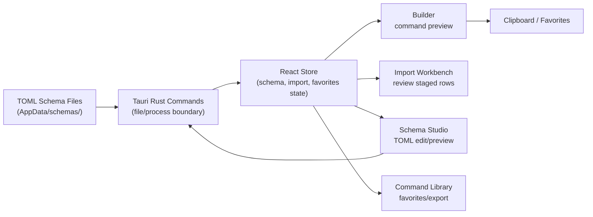

# CommandWizard


CommandWizard is a schema-driven desktop application that builds CLI command strings through a guided wizard interface. The original verified release is WPF/.NET; the active in-place v2 rebuild is Tauri, React, TypeScript, Tailwind, and Rust.

Schemas are defined in TOML files stored locally — no cloud sync, no telemetry.

v1.0.5 shipped as a locally-signed MSIX; 26/26 tests pass on .NET 10.

The Tauri v2 implementation is present in this repo but is not release-verified yet.


Quick links: [Project README](Project-README.md) | [Release Notes](RELEASE-v1.0.5.md) | [Manifest](CommandWizard.manifest.toml)

---

## What This Project Covers

| Area | Summary |
|------|---------|
| Builder | Select a schema, configure options and parameters, preview and copy the assembled command |
| Import Workbench | Capture or paste help text, stage actions/arguments/parameters, review warnings, merge completion data, then save |
| Schema Studio | Create and edit TOML tool schemas — name, description, actions, arguments, parameters, tags, notes, value styles |
| Favorites | Save, search, filter by tag, copy, and export generated commands to JSON or plain text |
| Schema Storage | Local `.toml` files in the user's AppData folder; fully portable and editable by hand |
| Legacy WPF Release | Locally-signed MSIX built with `scripts\package-msix.ps1`; preserved as v1.0.5 release evidence |

---

## Verified WPF Result

| Metric | Value |
|--------|-------|
| Build | `dotnet build -c Release` |
| Test suite | `26/26 passed` |
| MSIX signature | `Valid` |
| Installed version | `1.0.5.0` |
| Date verified | `2026-07-12` |
| Result | Release build, all tests green, MSIX installs and launches |

Evidence bundle at `release-evidence/v1.0.5/` (build.log, test.log, filehash.txt, install-check.txt).

---

## Architecture at a Glance



The v2 app uses Tauri for local filesystem and help/completion capture, while React owns command-building, import review, schema editing, and favorites state. The v1 WPF application remains in the repo as release-verified lineage.

---

## Repository Layout

```text
src/                          Tauri v2 React/TypeScript implementation
src-tauri/                    Rust command layer, app config, native tests
tests/                        Playwright smoke tests
Project-Proposal.md           PPS proposal for the v2 rebuild
CommandWizard.csproj          Legacy WPF application project
MainWindow.xaml / .cs         Legacy shell window and event routing
ViewModels/                   Legacy MainViewModel, ToolSchemaViewModel, and item VMs
Services/                     Legacy SchemaSerialization, HelpSchemaImporter, CommandBuilder, AppLogger
schemas/                      Bundled starter schema files (e.g. rsync.toml)
CommandWizard.Tests/          Legacy xUnit test project
scripts/package-msix.ps1      Repeatable MSIX packaging script
dist/                         Built MSIX artifacts
release-evidence/             Per-version build, test, and install evidence
CommandWizard.manifest.toml   Machine-readable project manifest
```

---

## v2 Components

### Builder

Select a schema, choose an optional action, fill options and parameters, preview the assembled command, copy it, or save it to favorites.

### Import Workbench

Capture live help output or parse pasted help text. The workbench stages detected actions, arguments, and parameters in editable buckets, shows parse warnings, optionally merges completion data, and saves only after review.

### Schema Studio

Edit schema metadata, actions, arguments, parameters, tags, notes, value styles, and preview the TOML output before saving.

### Command Library

Search, tag-filter, copy, remove, clear, and export favorite commands.

### Settings / Evidence

Shows the local data root, Blue Slate adoption, safety boundary, WPF lineage, schema/favorite counts, and runtime log text.

## Legacy WPF Components

### `MainViewModel`

Central state owner for the application. Loads schemas on startup, manages filtered views, coordinates the wizard and favorites, and delegates to services for save, import, and build operations.

- Schema CRUD: load all `.toml` files from AppData, add/save/delete schemas
- Wizard state: selected tool, selected action, option/parameter values, command preview
- Favorites: add, remove, clear, export (JSON or plain text), tag-filtered view

### `SchemaSerialization`

Stateless TOML parse and serialize service backed by Tomlyn.

- Parses `[tool]`, `[[actions]]`, `[[arguments]]`, `[[parameters]]`, `[[tags]]` sections
- Round-trips all fields; unknown fields are not preserved (intentional — schemas are canonical)
- Throws `InvalidOperationException` with the TOML diagnostic on any parse error

### `HelpSchemaImporter` / `HelpTextParser`

Import pipeline that produces a `ToolSchema` from a live command or pasted help text.

- Runs `<command> <helpArgs>` and captures stdout/stderr
- Parses flags (`-f`, `--flag`), descriptions, and argument types from common help formats
- Optional advanced mode reads completion scripts for richer metadata
- Excluded-flags list lets you drop noisy or irrelevant options before saving

---

## Data, Storage, or Artifact Model

| Artifact | Purpose |
|----------|---------|
| `AppData/.../schemas/*.toml` | One TOML file per tool schema; read on startup, written on save, deleted on delete |
| `AppData/.../history.json` | JSON array of saved favorite commands with tool, action, task, and timestamp |
| `dist/CommandWizard-1.0.5.0.msix` | Signed MSIX installer; SHA-256 `24557F...C6733` |
| `release-evidence/v1.0.5/` | Build log, test log, file hash, and install check for the v1.0.5 release |

All user data lives under `%LOCALAPPDATA%\Aptlantis\CommandWizard\` (resolved by `AppPaths.ResolveDataRoot()`). The AppData folder is not removed by MSIX uninstall — user schemas and favorites persist.

---

## Manifest and Audit Trail

`CommandWizard.manifest.toml` is the machine-readable project record.

Common fields:

- `entity.status` — project lifecycle state (`paused`, `active`, `archived`)
- `verification.build_verified` / `tests_verified` / `artifact_verified` / `release_verified`
- `release.installer.sha256` — hex SHA-256 of the MSIX artifact
- `release.installer.certificate_thumbprint` — signing cert thumbprint
- `release.verification.test_result` — test suite outcome at release time
- `tag_colors` — display color hex codes for each entity tag

| Status | Meaning |
|--------|---------|
| `metadata-reconciled` | Fields reviewed against evidence; build/test not re-run |
| `release-verified` | Clean build, all tests, MSIX signed and installed |
| `paused` | No active development; production artifact exists |

---

## Observability

| Surface | Purpose |
|---------|---------|
| View Log button (Schema Editor tab) | Opens the AppData log file in the default text editor |
| `AppLogger` (Services/AppLogger.cs) | Logs import start/success/failure and schema save/delete events |
| `Get-AuthenticodeSignature` | Verify MSIX signature before installation |

Important signals:

- Log lines beginning `Import failed:` indicate the help importer could not parse the command output
- `Schema saved:` / `Schema deleted:` lines confirm file operations succeeded
- A missing `AppData/.../schemas/` directory on first launch is normal — the app creates it and shows a guidance message
- `Passed! - Failed: 0, Passed: 26` in `release-evidence/v1.0.5/test.log` is the passing baseline

---

## Quick Start

### Prerequisites

- Node.js/npm and Rust/Tauri prerequisites for v2 development
- Windows 10 or later for the legacy MSIX (Windows App SDK runtime bundled in the MSIX)
- Local dev certificate trusted on the machine (required for locally-signed MSIX only)
- At least one `.toml` schema file in `%LOCALAPPDATA%\Aptlantis\CommandWizard\schemas\`

### Setup

```powershell
# Trust the dev certificate once per machine
Import-Certificate -FilePath .\devcert.cer -CertStoreLocation Cert:\LocalMachine\TrustedPeople

# Install the MSIX
Add-AppxPackage .\dist\CommandWizard-1.0.5.0.msix
```

### Build Tauri v2

```powershell
npm install
npm run build
npm run test
npm run test:rust
npm run tauri:dev
```

### Build Legacy WPF

```powershell
dotnet build .\CommandWizard.csproj -c Release
```

### Run

```powershell
# Launch from Start menu: "Aptlantis Command Wizard"
# Or from the build output:
.\bin\Release\net10.0-windows10.0.26100.0\CommandWizard.exe
```

### Verify

```powershell
dotnet test .\CommandWizard.Tests\CommandWizard.Tests.csproj -c Release
Get-AuthenticodeSignature .\dist\CommandWizard-1.0.5.0.msix
```

---

## Primary Workflow

Select a schema in the **Wizard** tab, fill in the options and parameters, then copy or save:

```powershell
# Generate a schema from a command's help output
# (use Import From Help... in the Schema Editor tab)
rsync --help

# After reviewing and saving the imported schema, switch to the Wizard tab:
# 1. Select "rsync" from the tool list
# 2. Check -a (archive), --delete, --progress
# 3. Fill in source and destination paths
# 4. Click Copy or Save (Ctrl+C / Ctrl+G)
```

Expected output:

```text
rsync -a --delete --progress /mnt/source/ /mnt/dest/
```

---

## Operational Guidance

- Schema files are plain TOML and can be edited by hand outside the app — the app reloads from disk on next launch
- The "Delete Schema" button in the Schema Editor removes both the in-memory entry and the `.toml` file on disk; confirm before clicking
- Use "Export" in the Favorites tab to back up saved commands before uninstalling
- Favorites are stored in `history.json` — copy that file to migrate to another machine
- For the MSIX to install without prompts, the certificate must be in **both** `TrustedPeople` and `TrustedRoot` stores

---

## Development

Build:

```powershell
dotnet build .\CommandWizard.csproj -c Release
```

Test:

```powershell
dotnet test .\CommandWizard.Tests\CommandWizard.Tests.csproj -c Release
```

Package MSIX:

```powershell
.\scripts\package-msix.ps1
```

Current legacy automated coverage includes 26 xUnit tests covering schema serialization round-trips, command builder output, help text parsing, and import pipeline logic.

The v2 scaffold adds Vitest coverage for schema parsing/serialization, command building, help import, favorites, and shell rendering; Rust tests for schema IO helpers and native safety helpers; and Playwright smoke tests for Builder and Import Workbench.

---

## Documentation Map

| File | Purpose |
|------|---------|
| [README.md](README.md) | This file — project overview and quick start |
| [Project-README.md](Project-README.md) | Governance entry point — build commands, known gaps, manifest links |
| [Project-Proposal.md](Project-Proposal.md) | PPS intent record for the Tauri v2 rebuild |
| [RELEASE-v1.0.5.md](RELEASE-v1.0.5.md) | v1.0.5 release notes — installer, SHA-256, theme, design boundaries, built with |
| [AGENTS.md](AGENTS.md) | Agent modification instructions |
| [CommandWizard.manifest.toml](CommandWizard.manifest.toml) | Machine-readable project manifest |

---

## Release Posture

CommandWizard has a stable, locally-signed WPF production artifact and an active in-place Tauri v2 rebuild. Do not treat the Tauri app as release-verified until its DRS evidence bundle exists.

| Field | Value |
|-------|-------|
| Stage | WPF production, Tauri rebuild |
| Completion | 95% |
| Stability | WPF stable, Tauri pre-release |
| Technical debt | low |
| Maintenance burden | low |
| License | MIT |
| Maintainer | Herb |

---

## Core Principles

**Local-first**
All data — schemas, favorites, logs — lives in the user's AppData folder. No network calls, no accounts, no telemetry.

**Schema-driven, not code-driven**
Command structure is described in TOML, not compiled in. Adding a new tool means dropping a `.toml` file, not writing code.

**No generated command execution**
The wizard assembles command strings for the clipboard and favorites. It does not execute generated commands. Tauri help/completion capture is limited to explicit import probes.

**Transparent artifacts**
Every release ships with a SHA-256 hash, a signed MSIX, and an evidence bundle (build log, test log, install check) so the release can be independently verified.

---

## Roadmap

- [ ] Complete Tauri dependency install and local launch verification
- [ ] Complete Tauri package verification and DRS evidence bundle
- [ ] Decide whether the WPF implementation moves to archived lineage after v2 release
- [ ] Automated UI smoke tests in the release checklist
- [ ] SBOM (CycloneDX/JSON) generation for public releases

---

## License

MIT License. See [LICENSE](LICENSE) for details.

---

## Author

Maintained by Herb.

```html
<script type="application/ld+json">
{
  "@context": "https://schema.org",
  "@type": "SoftwareSourceCode",
  "name": "CommandWizard",
  "description": "Schema-driven WPF desktop application that builds CLI command strings through a guided wizard interface.",
  "license": "https://opensource.org/licenses/MIT",
  "programmingLanguage": ["C#", "XAML"],
  "author": {
    "@type": "Person",
    "name": "Herb"
  }
}
</script>
```
