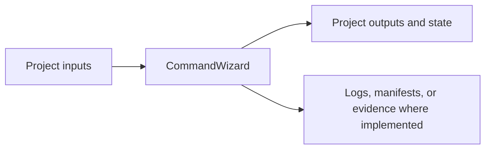

# CommandWizard


Local-first Tauri desktop application for constructing and managing command workflows from TOML schemas.

This documentation update did not run product verification. Consult the dated project, test, and release records below for evidence and its limits.

Quick links: [Project context](Project-README.md) | [Proposal](Project-Proposal.md) | [Manifest](CommandWizard.manifest.toml)

The current Builder has **General**, **PowerShell**, and **Linux (WSL)** tabs. Choose a command's category in Schema Studio for imported apps. Command Preview is visible only in Builder, Parameters sit above Options, empty parameter sections are hidden, and CLI navigation is hidden. See [the dated maintenance record](docs/Command-Categories-2026-10-12.md) for verification; the retained guide below describes the historical release.

---

## What This Project Covers

| Area | Summary |
|------|---------|
| Current Release | Current version: **CommandWizard v2.0.0**. The v2.0.0 stable release is locally verified for Windows x64. The canonical private release artifact is `artifacts/installer/CommandWizard-2.0.0.0-win-x64.exe`, with release... |
| Product surfaces | / Area / Summary / / Builder / Select a tool schema, configure actions, options, and parameters, then copy or favorite the generated command / |
| Repository layout | src/ React/TypeScript app src-tauri/ Rust command layer, app config, native tests |
| Development | npm install npm run dev |
| Data model | Schemas remain plain TOML: [tool] |
| Safety boundaries | See the retained technical guide for the documented details. |

---

## Verified Result

| Metric | Value |
|--------|-------|
| Current verification | Not rerun for this README update |
| Date verified | Not established by this documentation pass |
| Result | No new build, test, runtime, or release claim |

Historical or project-specific evidence remains in the technical guide and linked records; its original date and scope govern.

---

## Architecture at a Glance


This overview is intentionally limited; consult the implementation and documentation for the actual data flow.

---

## Repository Layout

```text
.claude/
.idea/
artifacts/
docs/
public/
schemas/
scripts/
src/
```
---

## Components

The repository areas listed above are described in their existing local documentation. This summary does not infer component contracts from folder names.

---

## Data, Storage, or Artifact Model

Project-specific inputs, persistent data, and generated artifacts are documented in the retained technical guide and manifest. No storage behavior is inferred here.

---

## Manifest and Audit Trail

The project manifest is the machine-readable identity and lifecycle record: [CommandWizard.manifest.toml](CommandWizard.manifest.toml).

This README update changes documentation presentation only; it does not alter project audit, release, or run records.

---

## Observability

See the retained technical guide for documented logs, diagnostics, metrics, and status surfaces. No observability capability is claimed by this summary.

---

## Quick Start

Use the setup and run instructions in the retained technical guide or linked quickstart. Commands were not executed or inferred during this documentation pass.

---

## Primary Workflow

Follow the project-specific workflow documented in the retained technical guide. Review destructive actions and generated outputs according to the project's own governance records.

---

## Operational Guidance

- Read the local instructions and project manifest before changing the project.
- Treat build, test, runtime, packaging, deployment, and release evidence as separate claims.
- Preserve the detailed project-specific instructions in the guide below.

---

## Development

No build, test, formatter, or linter was run for this documentation-only update. Consult the retained guide for supported development commands.

---

## Documentation Map

| File | Purpose |
|------|---------|
| [AGENTS.md](AGENTS.md) | Project context or governance record. |
| [Project-README.md](Project-README.md) | Project context or governance record. |
| [Project-Proposal.md](Project-Proposal.md) | Project context or governance record. |
| [PROJECT-READMAP.toml](PROJECT-READMAP.toml) | Project context or governance record. |
| [CommandWizard.manifest.toml](CommandWizard.manifest.toml) | Machine-readable project manifest. |

---

## Release Posture

The current project status is **active** according to the available manifest. This status is not a release-readiness claim.

| Field | Value |
|-------|-------|
| Stage | active |
| Completion | Not asserted |
| Stability | Not established here |
| Technical debt | See project records |
| Maintenance burden | Not assessed here |
| License | not-recorded |
| Maintainer | See manifest |

---

## Core Principles

**Evidence stays scoped.**  
Use dated project records for build, test, runtime, and release claims.

**Project details stay authoritative.**  
The retained technical guide and local governance records define actual behavior.

---

## Roadmap

See the project proposal and roadmap records, if present. This README update adds no roadmap commitments.

---

## License

not-recorded. License terms are not identified in the current root records.

---

## Author

Maintainer information is recorded in the project manifest where available.

<details>
<summary>Current technical guide (retained without content edits)</summary>

# CommandWizard


CommandWizard is a local-first desktop app for building CLI command strings from TOML schemas. The canonical implementation is now Tauri v2, React, TypeScript, Tailwind v4, and Rust.

Generated commands are copy/export only. CommandWizard does not run generated commands.

Quick links: [Project README](Project-README.md) | [Proposal](Project-Proposal.md) | [Manifest](CommandWizard.manifest.toml)

## Current Release

Current version: **CommandWizard v2.0.0**.

The v2.0.0 stable release is locally verified for Windows x64. The canonical private release artifact is `artifacts/installer/CommandWizard-2.0.0.0-win-x64.exe`, with release notes in `docs/CommandWizard v2.0.0 - Stable Command Workspace Release.md`.

## Product surfaces

| Area | Summary |
|------|---------|
| Builder | Select a tool schema, configure actions, options, and parameters, then copy or favorite the generated command |
| Import Workbench | Capture or paste help text, review detected actions/arguments/parameters/warnings, optionally merge completion data, then save |
| CLI Import | Import a local script into a managed command directory, capture its help text, parse a schema, and save the reviewed command surface |
| Schema Studio | Edit metadata, actions, arguments, parameters, tags, notes, value styles, and highlighted TOML preview |
| Command Library | Search, tag-filter, copy, remove, clear, and export favorite commands |
| Settings / Evidence | Show the data root, Blue Slate adoption, safety boundary, schema/favorite counts, runtime label, and logs |

## Repository layout

```text
src/                          React/TypeScript app
src-tauri/                    Rust command layer, app config, native tests
public/vendor/prism/          Bundled Prism Okaidia assets for TOML highlighting
schemas/                      Starter TOML schemas
tests/                        Playwright smoke tests
scripts/playwright-smoke.ps1  Preview-server smoke helper
Project-Proposal.md           PPS proposal for the rebuild
Project-README.md             Governance and handoff entry point
CommandWizard.manifest.toml   Machine-readable project manifest
```

## Development

```powershell
npm install
npm run dev
npm run build
npm run test
npm run test:rust
npm run test:ui
npm run tauri:dev
npm run tauri:build
```

## Data model

Schemas remain plain TOML:

```toml
[tool]
name = "rsync"
description = "Fast file synchronization tool"

[[arguments]]
flag = "-a"
long = "--archive"
description = "archive mode"
type = "boolean"
value_style = "space"
```

User data is local:

| Artifact | Purpose |
|----------|---------|
| `schemas/*.toml` | One schema per command-line tool |
| `bin/*` | Managed launcher shims for imported CLI scripts; add this directory to PATH manually |
| `cli/scripts/*` | Managed copies of imported script files |
| `history.json` | Saved favorite commands |
| `logs/commandwizard.log` | Local runtime log |

On Windows, the app preserves the existing logical data path under `%LOCALAPPDATA%\Aptlantis\CommandWizard\`. On macOS and Linux, Tauri resolves the platform app data folder and uses the same `Aptlantis/CommandWizard` layout.

## Safety boundaries

- Generated commands are never executed.
- Help capture and completion probing are explicit import probes only.
- CLI import creates launcher shims in a managed local `bin` directory, but does not edit PATH automatically.
- Browser preview cannot run local command capture; paste help text there instead.
- Destructive operations, such as deleting a schema or clearing favorites, require confirmation.
- No cloud sync, accounts, telemetry, or automatic PATH modification are included.

## Verification

Current checks:

```powershell
npm run build
npm run test
npm run test:rust
npm run test:ui
```

The v2.0.0 Tauri app is local-verified under DRS. Full installer install/uninstall was not executed during this local verification pass; launch behavior was verified from the packaged release executable.

## Core principles

**Local-first**  
Schemas, favorites, and logs stay on the user's machine.

**Schema-driven**  
Command structure is described in TOML, so adding a tool is a data change rather than a code change.

**Review before save**  
The Import Workbench stages detected rows and warnings before writing a schema.

**Cross-platform desktop**  
Tauri owns the local filesystem and process boundary; React owns the workflow UI.

## License

MIT License.

## Author

Maintained by Herb.


</details>
